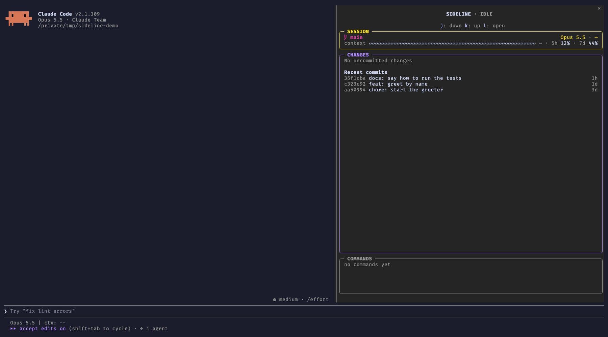

[Sideline](https://github.com/artberri/sideline) is a [Claude Code mod](https://code.claude.com/docs/en/plugins/mods/overview) that does two things: it removes the noise from Claude's conversation, and it moves the details I still care about (the files Claude changes, their diffs and the commands it runs) to a pane at its side. If you don't want to read the whole post, these two commands install it:

```sh
claude plugin marketplace add artberri/claude-plugins
claude plugin install sideline@artberri
```



## Too Much Noise

Let me be fair first: Claude Code made the CLI cool again. I love its UX, and Claude's team has done something more: a lot of people who didn't use the terminal are back on it, every day.

And that's great, but the conversation talks too much.

When Claude works, the conversation fills up with things I rarely read: whole shell scripts, the full diff of every edit, "Ran 1 shell command" lines,... After a long task, finding what Claude actually said means scrolling through a wall of output.

Most of the time, I don't care about the exact command Claude runs. I care about what it does, and Claude usually describes that anyway. The same happens with diffs: squeezed into the conversation, they are hard to read, and they push Claude's explanation off the screen.

**That's the core of Sideline: the conversation is for what Claude says and does, in prose, and the rest goes to the side.** With Sideline:

- a described shell command shows its description, not the whole script;
- an edit is a single line with its counts, like `Update(src/greet.js) (+4 -0)`;
- the finished "Ran 1 shell command" and "Read 2 files" lines go away.

Nothing is lost. ctrl+o still shows everything, and each of these changes can be turned off.

## But I Still Want to See the Code

Don't get me wrong, I'm not someone who lets the agent fly free and never looks at what it writes. I care about the code and about every file Claude touches. As I explained in [Programming with AI, Without the Hype](/blog/2026/02/programming-with-ai/), the human has to stay in control, and that's why I often want to know which files have been modified and what the modifications are.

That meant switching between Claude Code and my IDE all day long. So the other half of Sideline is the pane:

- **CHANGES**: a tree of the changed files with their `+N -N` counts. The file Claude is editing shimmers, so you can see live what's changing, and each file's diff is one click away. With nothing changed, it lists the recent commits instead.
- **COMMANDS**: the latest shell commands Claude ran, running, done or failed. Click one to read it whole.
- **SESSION**: the branch, the model and effort, how full the context is, and your usage limits.

Now the conversation tells me what Claude is doing, and the pane shows me what it's changing, without leaving Claude Code.

## Is It for You?

The pane docks beside the conversation in the fullscreen layout, and it opens by itself when your terminal is at least 144 columns wide. Claude Code Desktop docks it too.

If you don't use Claude Code full-screen, Sideline might not be for you. Anyway, you can try it because the cleaner conversation still works without the pane (use `/sideline` to toggle it).

## The Hard Part: Trust

This post is not about how to build a mod. The [official documentation](https://code.claude.com/docs/en/plugins/mods/create) is clear, and it even explains how to ask Claude to write one for you.

In fact, building Sideline was the easy part. The documentation is good, and there are good examples to learn from: Sideline is a smaller take on [claude-code-filetree](https://github.com/data-goblin/claude-code-filetree) by Kurt Buhler, and its look follows [claude-flightdeck](https://github.com/scasella/claude-flightdeck) by Stephen Casella. And Claude did most of the job.

So, if the code was easy, what was hard? Trust.

A mod is much more than a theme. As [the documentation](https://code.claude.com/docs/en/plugins/mods/overview#what-a-mod-can-reach) says, a mod runs with your permissions: it can read and write your files, start programs and make network requests, and **it sees every prompt you send and every tool call Claude makes**. Mods aren't sandboxed. In other words, a mod can read your chats.

That's a lot of power. I wouldn't install a mod like that without knowing exactly what it does, so I made some clear decisions:

- It only watches and reads. Every hook passes its event on unchanged: it never approves, refuses or edits a tool call or a prompt.
- Nothing leaves your machine. No network requests, no model calls, no dependencies.
- It runs a fixed list of read-only `git` commands (plus `uname` and `fc-list`, to choose its icons), and nothing you or Claude type goes into them.

**If a mod can read your chats, its README has to tell you exactly what it does with them.** That's why Sideline's README has a long "What it can see and do" section, with every command it runs.

And you don't need to trust the README either. `claude plugin validate` lists every event a mod hooks and every call it makes, without running it. So, before installing Sideline, you (or Claude, if you ask it whether Sideline is safe) can check that the list matches what the README promises.

I didn't build Sideline for you. I built it for me, and I use it every day, but as always, I'm happy to share it: [try it](https://github.com/artberri/sideline), and tell me what you'd change.
